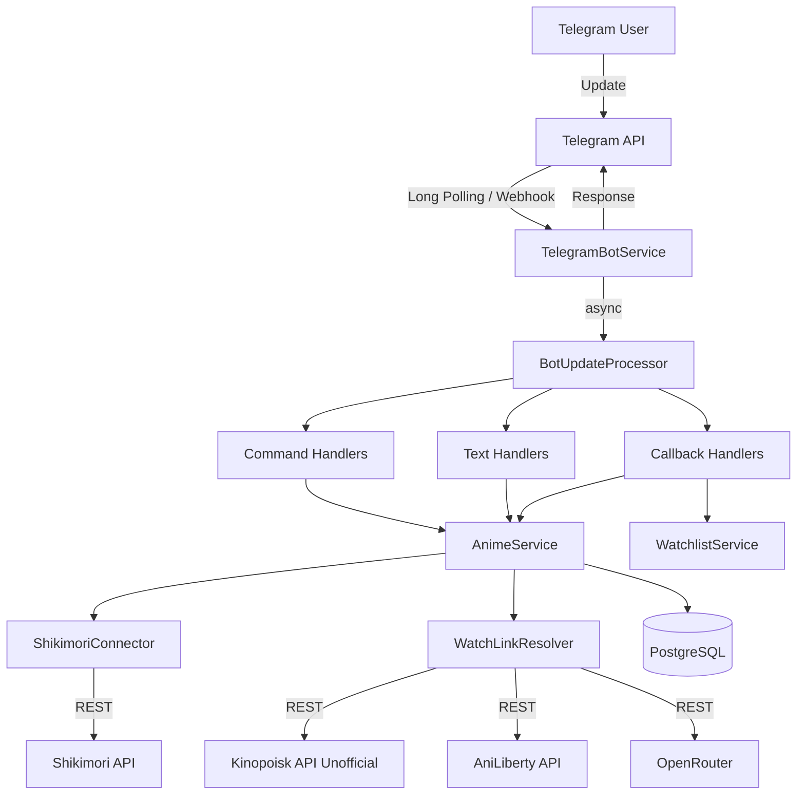
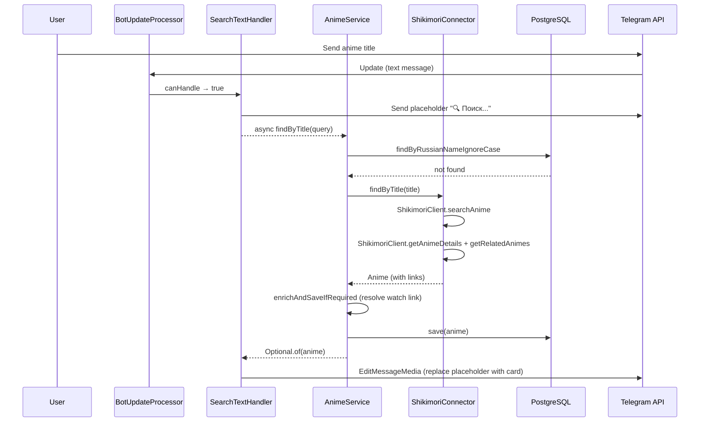
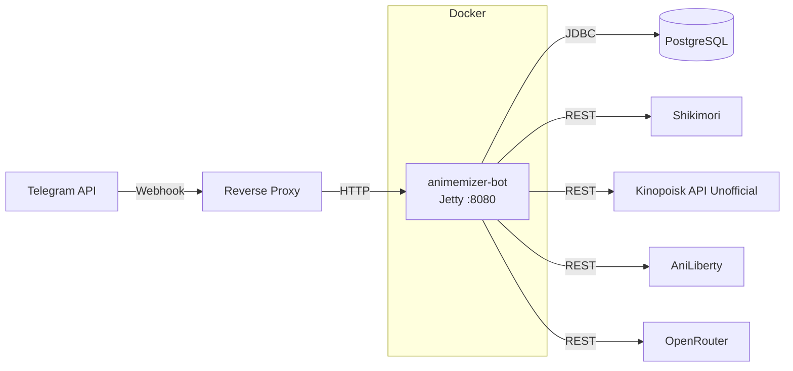

# Animemizer Bot

A Telegram bot for anime discovery and watchlist tracking. Search for anime by title, track your watching progress, navigate between related seasons, and find watch links across multiple anime databases.

## Table of Contents

- [Overview](#overview)
- [Features](#features)
- [Telegram Bot Commands](#telegram-bot-commands)
- [Supported Anime Providers](#supported-anime-providers)
- [Architecture](#architecture)
- [Technology Stack](#technology-stack)
- [Project Structure](#project-structure)
- [Prerequisites](#prerequisites)
- [Configuration](#configuration)
- [Environment Variables](#environment-variables)
- [Local Development](#local-development)
- [Running Tests](#running-tests)
- [Building the Application](#building-the-application)
- [Docker Usage](#docker-usage)
- [Deployment Overview](#deployment-overview)
- [Troubleshooting](#troubleshooting)
- [Security Notes](#security-notes)
- [Development Guidelines](#development-guidelines)
- [Known Limitations and TODOs](#known-limitations-and-todos)

## Overview

Animemizer Bot is a Spring Boot application that integrates with Shikimori for anime data and Kinopoisk API Unofficial, AniLiberty, and OpenRouter to resolve watch links, providing a unified anime search and tracking experience through Telegram. Users can search for anime, track episode progress with inline keyboard buttons, set watch statuses, navigate prequel/sequel chains, batch-search multiple titles, and get a direct watch link for each anime.

The bot operates in two modes: **long polling** (development) and **webhook** (production), selected via Spring profiles.

## Features

- **Anime Search** — type any anime title in the chat to find it via Shikimori's API, with results displayed as an interactive card with poster, description, and inline keyboard
- **Batch Search** — search for multiple anime titles at once with `/batch`, separated by commas (up to 300 titles)
- **Episode Tracking** — increment or decrement watched episodes directly from the anime card via `+1` / `-1` buttons
- **Watch Status Management** — set status to Watching, Planned, Completed, On Hold, or Dropped via inline buttons
- **Prequel/Sequel Navigation** — navigate anime franchise chains with directional buttons
- **Watchlist** — view all tracked anime in a paginated list sorted alphabetically
- **Watch Link** — a single "Смотреть" button shown when a link is found via Kinopoisk or AniLiberty
- **Watch Link Enrichment** — anime records are automatically enriched with a watch link on first access
- **Placeholder-then-Replace** — slow operations (search, list) show an immediate loading indicator, then replace it with the actual result

## Telegram Bot Commands

| Command | Description |
|---------|-------------|
| `/start` | Start the bot and show a welcome message. Registers the user if new. |
| `/help` | Display all available commands with descriptions. |
| `/stop` | Show a farewell message. |
| `/list` | Show your personal anime watchlist as a paginated list (20 items per page) with navigation buttons. |
| `/batch` | Batch-search multiple anime titles. Pass comma-separated titles after the command. |

Additionally, any **plain text message** (not starting with `/`) is treated as an anime search query.

The `/search` command prefix is also supported as an alias for plain-text search.

### Inline Keyboard Buttons

When an anime is found, the bot displays an interactive card with these button groups:

| Button | Action |
|--------|--------|
| `-1 серия` | Decrease watched episode count |
| `+1 серия` | Increase watched episode count |
| `⬅️ Предыстория` | Load the prequel anime (if available) |
| `Продолжение ➡️` | Load the sequel anime (if available) |
| `👀` / `📋` / `✅` / `⏸` / `❌` | Set watch status (Watching / Planned / Completed / On Hold / Dropped) |
| `🔄` | Force-sync with Shikimori to pick up newly released episodes (ongoing anime only; at most once per 12 hours, otherwise does nothing) |
| `Смотреть` | Direct watch link (shown only when a link was resolved) |

## Supported Anime Providers

| Provider | Role | Integration Method |
|----------|------|-------------------|
| **Shikimori** | Primary source — search, details, relations | `@HttpExchange` REST client (JSON API) |
| **Kinopoisk API Unofficial** | Searches for matching Kinopoisk films and series | `@HttpExchange` REST client |
| **AniLiberty** | Fallback anime release search | `@HttpExchange` REST client |
| **OpenRouter** | Selects the best matching Kinopoisk/AniLiberty result | `@HttpExchange` chat-completions client |

**Shikimori** is the primary data source — all anime search and detail fetching goes through its API. Watch-link lookup searches Kinopoisk first, then AniLiberty; **OpenRouter** selects only from returned candidates, and generated URLs are never accepted. AniLiberty results include the anime's Shikimori ID as a matching signal. Failed lookups are cached for 24 hours to avoid repeated searches.

### Watch Link Resolution

`KinopoiskWatchLinkResolver` resolves a single watch URL in this order:

1. Search Kinopoisk API Unofficial by the Russian anime title and ask OpenRouter to select the matching film or series. For a numbered later season, if selection fails, also search by the base title and accept a uniquely matching series or first season. Season availability in its player is not verified. Build the Kinopoisk URL and replace `kinopoisk.ru` with `kinokino.red`.
2. If no suitable Kinopoisk result is selected, search AniLiberty releases. OpenRouter selects a candidate using its title, year, and Shikimori ID; construct the link from its `alias` as `https://www.aniliberty.top/anime/releases/release/{alias}/episodes`.
3. If neither source yields a valid candidate, no watch button is shown.

## Architecture

### Update Processing Flow

```
Telegram Update
  ├── Long Polling (dev profile) ──┐
  └── Webhook POST (prod profile) ─┤
                                    ▼
                          TelegramBotService.consume()
                                    │
                                    ▼ (async via virtual thread executor)
                          BotUpdateProcessor.processUpdate()
                                    │
                        ┌───────────┼───────────┐
                        ▼           ▼           ▼
                   CallbackQuery  TextMessage  Other
                        │           │           │
                        ▼           ▼           ▼
                 CallbackHandler  TextHandler  "Unsupported"
                 chain (first    chain first,    reply
                  match wins)    then CommandHandler
                                      fallback
```

**Key routing rules:**
- TextHandlers are checked **before** CommandHandlers
- `SearchTextHandler` catches all non-command text AND `/search`
- Callbacks are matched by prefix (e.g., `NEXT_EPISODE:`)
- Returning `null` from a handler means "I'm managing my own Telegram responses" (placeholder-then-replace pattern)

### Placeholder-then-Replace Pattern

For slow operations (search, list, batch, prequel/sequel navigation):

1. Send a placeholder message (e.g., "🔍 Поиск...") immediately
2. Perform the async operation
3. Edit the placeholder in-place with the result (`EditMessageText`, `EditMessageCaption`, or `EditMessageMedia`)
4. If the placeholder send fails, return the result directly as a fallback

### Watch Link Enrichment

`AnimeService.enrichAndSaveIfRequired()` is called on every anime fetch. It resolves a watch link via `WatchLinkResolver` (Kinopoisk, then AniLiberty) when the anime has none, and persists the result. Failed lookups are cached in the `providerFailures` Caffeine cache for 24 hours.

### Architecture Diagrams

#### High-Level Component Flow



#### Search Sequence Diagram



#### Deployment Architecture



## Technology Stack

| Component | Technology | Version |
|-----------|-----------|---------|
| Language | Java | 26 |
| Framework | Spring Boot | 4.1.1 |
| Web Server | Jetty (Tomcat excluded) | — |
| Data Access | Spring Data JDBC (not JPA) | — |
| Database (prod) | PostgreSQL | — |
| Database (test) | H2 (in-memory) | — |
| Caching | Caffeine via Spring Cache | — |
| Telegram | telegrambots (long-polling + Jetty client) | 10.3.0 |
| HTML Scraping | Jsoup | 1.23.2 |
| JSON | Jackson 3.x + Jackson 2.x (dual) | Managed by Spring Boot |
| Testing | JUnit 6 + AssertJ | — |
| Build | Maven (with Maven Wrapper) | — |
| Container | Docker + Docker Compose | — |
| Async | Virtual threads (enabled by default in Java 26) | — |

## Project Structure

```
animemizer-bot/
├── src/main/java/pro/zerobyte/animemizerbot/
│   ├── Application.java                    # Entry point (@EnableScheduling)
│   ├── bot/
│   │   ├── TelegramBotService              # Central update consumer, webhook/polling init
│   │   ├── processor/
│   │   │   └── BotUpdateProcessor          # Update routing (callback → text → command)
│   │   ├── handler/
│   │   │   ├── AnimemizerBotCommand        # Command enum (/start, /help, /stop, /list, /batch)
│   │   │   ├── AnimemizerBotCallback       # Callback enum + data parsing
│   │   │   ├── CommandHandler              # Interface for /command handlers
│   │   │   ├── CallbackHandler             # Interface for inline button handlers
│   │   │   ├── TextHandler                 # Interface for plain text handlers
│   │   │   ├── command/                    # StartCommandHandler, HelpCommandHandler, etc.
│   │   │   ├── callback/                   # EpisodeCallbackHandler, WatchStatusCallbackHandler, etc.
│   │   │   └── text/                       # SearchTextHandler
│   │   └── message/
│   │       ├── AnimeMessageBuilder         # Builds caption text and inline keyboards
│   │       └── TelegramMessageUtils        # Markdown escaping, description cleaning
│   ├── controller/
│   │   └── WebhookController               # Webhook endpoint (prod profile only)
│   ├── config/
│   │   ├── TelegramBotConfig               # TelegramClient, long-polling (dev), webhook (prod)
│   │   ├── HttpClientConfig                # RestClient + declarative HTTP clients
│   │   ├── CacheConfig                     # 4 Caffeine caches
│   │   ├── JacksonConfig                   # Jackson 3.x + 2.x mappers
│   │   ├── WebConfig                       # Custom Telegram JSON converter
│   │   ├── PropertiesConfig                # @EnableConfigurationProperties
│   │   └── props/
│   │       ├── TelegramBotProperties       # Bot token, username, webhook config
│   │       ├── ShikimoriProperties          # Shikimori API + poster base URL
│   │       ├── KinopoiskProperties         # Kinopoisk API key + base URL
│   │       ├── AnilibertyProperties        # AniLiberty base URL
│   │       └── OpenRouterProperties        # OpenRouter API key, base URL + model
│   ├── core/
│   │   ├── anime/
│   │   │   ├── Anime                       # Domain entity (record + @Table)
│   │   │   ├── AnimeSource                 # Enum: SHIKIMORI
│   │   │   ├── WatchLinkResolver           # Interface for watch link resolution
│   │   │   ├── AnimeRepository             # Spring Data JDBC repository
│   │   │   ├── AnimeService                # Main service: search, save, enrichment
│   │   │   └── AnimeListService            # Paginated watchlist logic
│   │   ├── watchlist/
│   │   │   ├── Watchlist                   # Watchlist entry entity
│   │   │   ├── WatchStatus                 # Enum with transition logic
│   │   │   ├── WatchlistRepository         # Repository
│   │   │   └── WatchlistService            # Episode tracking, status changes
│   │   ├── telegramuser/
│   │   │   ├── TelegramUser                # User entity
│   │   │   ├── TelegramUserRepository      # Repository
│   │   │   └── TelegramUserService         # User registration/lookup
│   │   └── service/
│   │       ├── JsonService                 # Jackson 3.x serialization
│   │       └── Json2Service                # Jackson 2.x serialization
│   ├── integration/
│   │   ├── shikimori/
│   │   │   ├── ShikimoriClient             # @HttpExchange REST client
│   │   │   ├── ShikimoriConnector          # Async fetch + caching
│   │   │   ├── ShikimoriMapper             # DTO → domain mapping
│   │   │   └── dto/                        # ShikimoriAnimeDto, ShikimoriAnimeRelatedDto
│   │   ├── kinopoisk/
│   │   │   ├── KinopoiskClient             # @HttpExchange REST client
│   │   │   ├── KinopoiskWatchLinkResolver  # Kinopoisk → AniLiberty resolution
│   │   │   └── dto/
│   │   ├── aniliberty/
│   │   │   ├── AnilibertyClient            # @HttpExchange REST client
│   │   │   └── dto/
│   │   └── openrouter/
│   │       ├── OpenRouterClient            # @HttpExchange chat-completions client
│   │       └── dto/                        # Chat completion request/response
│   └── exception/
│       ├── GlobalExceptionHandler          # @RestControllerAdvice
│       ├── JsonDeserializationException
│       └── JsonSerializationException
├── src/main/resources/
│   ├── application.yaml                    # Shared config
│   ├── application-dev.yaml                # Long polling, DEBUG logging
│   └── application-prod.yaml               # Webhook config, INFO logging
├── src/test/
│   ├── java/pro/zerobyte/animemizerbot/    # Unit + integration tests
│   └── resources/
│       ├── application-test.yaml           # H2, disabled cache, dummy tokens
│       ├── schema.sql                      # Test DB schema (3 tables)
│       └── json/shikimori/                 # JSON fixtures
├── Dockerfile
├── docker-compose.yml
├── pom.xml
├── mvnw / mvnw.cmd                         # Maven Wrapper
└── local_scripts/
    └── deploy_to_micro_2.sh                # Deploy script (internal)
```

## Prerequisites

- **Java 26** (JDK) — virtual threads are enabled by default
- **Maven 3.9+** or use the included Maven Wrapper (`./mvnw`)
- **Docker** and **Docker Compose** (for containerized deployment)
- **PostgreSQL** (for production; not required for development or testing)

## Configuration

### Spring Profiles

| Profile | Mode | Use Case |
|---------|------|----------|
| `dev` | Long polling | Local development (default) |
| `prod` | Webhook | Production deployment |
| `test` | H2 in-memory | Running tests |

### Application Properties

Configuration is split across three files:

- `application.yaml` — shared settings (database, Telegram tokens, provider URLs, cache)
- `application-dev.yaml` — dev-specific (DEBUG logging for app + Telegram)
- `application-prod.yaml` — prod-specific (webhook path + base URL, INFO logging)

Shikimori's API and poster host are configured with `shikimori.base-url` (default: `https://shikimori.io`). If you previously overrode `app.anime-sources.SHIKIMORI`, move that override to `shikimori.base-url`.

## Environment Variables

### Required for All Profiles

| Variable | Description | Example |
|----------|-------------|---------|
| `TELEGRAM_BOT_TOKEN` | Telegram Bot API token from @BotFather | `<TELEGRAM_BOT_TOKEN>` |
| `TELEGRAM_BOT_USERNAME` | Bot username (without @) | `animemizer_bot` |
| `TELEGRAM_BOT_API_SECRET_TOKEN` | Secret token for webhook validation | `<SECRET_TOKEN>` |
| `DATASOURCE_URL` | PostgreSQL JDBC URL | `jdbc:postgresql://localhost:5432/animemizer` |
| `DATASOURCE_USERNAME` | Database username | `<DATABASE_USERNAME>` |
| `DATASOURCE_PASSWORD` | Database password | `<DATABASE_PASSWORD>` |
| `KINOPOISK_API_KEY` | Kinopoisk API Unofficial key | `<KINOPOISK_API_KEY>` |
| `OPENROUTER_API_KEY` | OpenRouter API key for selecting search results | `<OPENROUTER_API_KEY>` |

### Required for Production (`prod` profile)

| Variable | Description | Example |
|----------|-------------|---------|
| `TELEGRAM_BOT_WEBHOOK_PATH` | URL path for webhook endpoint | `/webhook/telegram` |
| `TELEGRAM_BOT_WEBHOOK_BASE_URL` | Public base URL of the server | `https://your-domain.com` |

### Notes

- `TelegramBotProperties` uses `@Validated` + `@NotBlank` on `token` and `username` — the application will **fail to start** if these are missing.
- `KinopoiskProperties` uses `@Validated` + `@NotBlank` on `apiKey` — the application will **fail to start** if `KINOPOISK_API_KEY` is missing.
- `OpenRouterProperties` uses `@Validated` + `@NotBlank` on `apiKey` — the application will **fail to start** if `OPENROUTER_API_KEY` is missing. The model defaults to `openai/gpt-4o-mini` and can be changed with `openrouter.model`.
- Tests use dummy values from `application-test.yaml` — no environment variables are needed to run `mvn test`.
- The `secretToken` field in `TelegramBotProperties` is optional (no `@NotBlank`).

## Local Development

### 1. Clone and configure

```bash
git clone <repository-url>
cd animemizer-bot
```

### 2. Set environment variables

Create a `.env` file or export variables:

```bash
export TELEGRAM_BOT_TOKEN=<your-bot-token>
export TELEGRAM_BOT_USERNAME=<your-bot-username>
export TELEGRAM_BOT_API_SECRET_TOKEN=<your-secret-token>
export DATASOURCE_URL=jdbc:postgresql://localhost:5432/animemizer
export DATASOURCE_USERNAME=<db-username>
export DATASOURCE_PASSWORD=<db-password>
export KINOPOISK_API_KEY=<your-kinopoisk-api-key>
export OPENROUTER_API_KEY=<your-openrouter-api-key>
```

### 3. Run with Maven Wrapper

```bash
./mvnw spring-boot:run
```

This starts the bot with the `dev` profile (long polling) by default.

### 4. Verify

The bot connects to Telegram via long polling. Send `/start` to the bot in Telegram to verify it's running.

## Running Tests

```bash
./mvnw test
```

Tests use the `test` profile automatically, which configures:
- H2 in-memory database with auto-loaded schema
- Disabled caching (`spring.cache.type: none`)
- Dummy Telegram bot tokens

No environment variables are required.

To run a specific test class:

```bash
./mvnw test -Dtest=ClassName
```

### Testing Stack

- **JUnit 6** with **AssertJ** assertions
- **BDD style**: `// Given` / `// When` / `// Then` comments
- **Naming convention**: `should_[Expected]_when_[Condition]`
- **H2** in-memory database for repository/service tests
- **JSON fixtures** in `src/test/resources/json/shikimori/`
- **Test schema**: `src/test/resources/schema.sql` (anime, telegram_user, watchlist tables)

Existing PostgreSQL databases may still contain the unused `anime_link` table. Back up the database before removing it manually with `DROP TABLE IF EXISTS anime_link;`; the application does not modify existing schemas automatically.

The `REWATCHING` watch status was removed from the application. Before deploying, migrate existing rows — otherwise reading a `watchlist` row with `status = 'REWATCHING'` fails:

```sql
UPDATE watchlist SET status = 'WATCHING' WHERE status = 'REWATCHING';
```

### Test Coverage Areas

The test suite covers:
- Domain models (`AnimeTest`, `AnimeSourceTest`, `WatchStatusTest`)
- Shikimori mapper and DTO deserialization
- Handler logic (Start, Help, Stop, Search, Episode, Relation, WatchStatus, Callback parsing)
- Service layer (AnimeService, WatchlistService, TelegramUserService, ShikimoriConnector)
- Update routing (`BotUpdateProcessorTest`)
- Kinopoisk/AniLiberty watch link resolution (`KinopoiskWatchLinkResolverTest`)
- Message building (`AnimeMessageBuilderTest`, `TelegramMessageUtilsTest`)

## Building the Application

### Build JAR

```bash
./mvnw clean package
```

The JAR is produced at `target/animemizer-bot-1.0.0.jar`.

### Build and verify

```bash
./mvnw clean verify
```

## Docker Usage

### Build the image

```bash
docker build -t animemizer-bot:latest .
```

The Dockerfile uses `eclipse-temurin:26-jre-alpine`, sets timezone to `Europe/Warsaw`, creates a non-root user, and copies the built JAR.

### Run with Docker Compose

```bash
docker compose up -d
```

This starts the bot container with:
- `prod` profile active
- Memory limit: 416 MB (`-Xmx256m -Xms256m`)
- Read-only filesystem with 64 MB tmpfs at `/tmp`
- JSON log driver (max 10 MB per file, 3 files)
- 20-second stop grace period
- Connection to the `external-net` Docker network

The `.env` file in the project root is loaded automatically via `env_file`.

### Useful commands

```bash
docker compose logs -f bot        # View live logs
docker compose stop               # Stop services
docker compose down               # Stop and remove containers
docker compose up -d --build      # Rebuild and restart
```

## Deployment Overview

The project includes a deployment script at `local_scripts/deploy_to_micro_2.sh` that:

1. Builds the project with Maven (`mvn clean package`)
2. Copies the JAR, Dockerfile, `docker-compose.yml`, and `.env` to the remote server via SCP
3. Rebuilds and restarts the Docker containers on the remote server
4. Prunes unused Docker images

This script requires SSH access to the target server and is intended for internal use.

## Troubleshooting

### Bot doesn't respond

- Verify `TELEGRAM_BOT_TOKEN` is correct
- Check logs for `Failed to register bot menu commands` errors
- For webhook mode, ensure `TELEGRAM_BOT_WEBHOOK_BASE_URL` is publicly accessible and HTTPS
- For long polling mode, ensure no other bot instance is polling the same token

### Database connection errors

- Verify PostgreSQL is running and accessible at `DATASOURCE_URL`
- Check credentials in `DATASOURCE_USERNAME` / `DATASOURCE_PASSWORD`
- The connection pool is configured with max 20 connections, min 5 idle

### Search returns no results

- The bot searches by Russian name, English name, then original name (case-insensitive)
- If not found locally, it queries Shikimori's API
- Watch link resolution failures are cached for 24 hours — an anime whose link could not be found won't be retried until the cache expires

### Batch search is slow

- Batch search processes titles sequentially with a 400ms delay between each to avoid rate limiting
- Progress updates are sent every 10 titles
- Maximum 300 titles per batch

### Tests fail

- The test schema at `src/test/resources/schema.sql` must match the domain model
- If you add new entities or columns, update the schema accordingly

## Security Notes

- The webhook endpoint validates the `X-Telegram-Bot-Api-Secret-Token` header against the configured `TELEGRAM_BOT_API_SECRET_TOKEN`
- The Docker container runs as a non-root user (`botuser`)
- The Docker filesystem is read-only with a tmpfs mount for `/tmp`
- Input length limits: commands max 2000 chars, search queries max 255 chars
- Never commit secrets — the `.env` file is in `.gitignore`

## Development Guidelines

### Code Conventions

- **Constructor injection only** — no `@Autowired` on fields
- **Records** for all DTOs and domain entities
- **No `var`** — always use explicit type names
- **No `catch (Exception)`** — catch specific types, return `Optional.empty()` on failures
- **SLF4J with `LoggerFactory`** — no Lombok `@Slf4j`
- **Async**: `CompletableFuture` with `@Qualifier("applicationTaskExecutor") TaskExecutor` (virtual threads)
- **Stream Gatherers**: `Gatherers.windowFixed(n)` for partitioning (e.g., status buttons in rows of 3)

### Adding a New Command

1. Add entry to `AnimemizerBotCommand` enum
2. Create handler class in `bot/handler/command/` implementing `CommandHandler`
3. Annotate with `@Component` — auto-discovered via Spring list injection

### Adding a New Callback

1. Add prefix to `AnimemizerBotCallback` enum
2. Create handler class in `bot/handler/callback/` implementing `CallbackHandler`
3. Use `canHandle(callbackData)` to match by prefix

### Adding a New Watch Link Resolver

1. Create package under `integration/{provider}/`
2. Implement the `WatchLinkResolver` interface (`resolveWatchUrl(Anime)`)
3. For JSON APIs: create an `@HttpExchange` client interface and register it in `HttpClientConfig`
4. Add provider config to `application.yaml`

## Known Limitations and TODOs

- **Test schema sync** — the test `schema.sql` must be manually updated when domain entities change
- **`AnimeService` refactoring** — a TODO comment in the source notes the service mixes read and write concerns (enrichment happens on read paths)
- **No CI/CD pipeline** — there is no CI/CD configuration in the repository
- **No license file** — no license has been specified for this project
